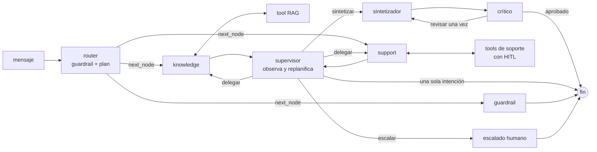

# Plan: iteración 2

Implementa la [especificación de la iteración 2](especificacion.md) y respeta la [constitución](../constitucion.md).

## 1. Arquitectura objetivo

El router sigue fijando `next_node` y conectándose con `add_conditional_edges` (contrato). El supervisor usa el mismo mecanismo para delegar.

## 2. Fases y calendario (hora de Ciudad de México)

| Orden | Fase | Contenido | Prio | Cuándo |
|---|---|---|---|---|
| 0 | Specs | Este documento, la especificación y las tareas | A | 19/11, 15:45 |
| 1 | Orquestación | ORQ2-01 a ORQ2-09 | A | 19/11, 16:00–18:30 |
| 2 | RAG | RAG2-01 a RAG2-04 | B | 19/11, 18:30–20:00 |
| 3 | Evaluación | EVAL2-01 a EVAL2-06 (necesita [Q-012](../preguntas.md#q-012) y tus etiquetas) | A | 20/11, 09:00–12:00 |
| 4 | Observabilidad | OBS2-01 a OBS2-05 | B | 20/11, 12:00–13:30 |
| 5 | Producción, seguridad y memoria | PROD2-01, SEC2-01, SEC2-02, MEM2-01 | C | 20/11, 13:30–15:30 |
| 6 | Cierre | README, specs, informes y tag `v6-reevaluacion` | A | 20/11, 15:30–16:30 |

Reglas:

1. `main` es entregable después de cada merge.
2. La evaluación (fase 3) se ejecuta sobre el sistema con la orquestación y el RAG nuevos, para medir lo que se entrega.
3. Si a las 15:30 del 20/11 la fase 5 no está en verde, se aparca y se pasa al cierre.

## 3. Diseño de la orquestación

- **Estado.** Se añaden `plan` (subtareas con especialista, objetivo y estado), `findings` (lo que devuelve cada especialista y sus fuentes), `hops`, `route` y `review`. No tienen reducer: el router los reinicia en cada turno, así que no se mezclan entre turnos.
- **Router.** `RouteDecision` añade un campo `plan`. `next_node` sigue siendo la ruta del primer paso. Si el modelo no devuelve plan, se usa una sola subtarea con el mensaje del usuario.
- **Especialistas.** Reciben en el prompt la subtarea asignada y los hallazgos anteriores del turno. Su bucle ReAct no cambia: como máximo 3 herramientas por turno. Al terminar, van al supervisor en lugar de al final.
- **Supervisor.** Registra el hallazgo y decide con salida estructurada y fail-closed: delegar en `knowledge` o `support` con un objetivo (que puede ser nuevo, es decir, replanificar), sintetizar o escalar. Si hay 4 saltos o no hay progreso, sintetiza.
- **Vía rápida.** Si el plan tenía una sola subtarea y está hecha, el supervisor termina sin llamar al LLM, y la respuesta es la del especialista.
- **Sintetizador.** Integra los hallazgos en una sola respuesta, en el idioma del usuario y con sus fuentes.
- **Crítico.** Con salida estructurada, aprueba la síntesis o pide una revisión con motivos. Solo hay una revisión; si vuelve a fallar, se entrega con una advertencia y queda registrado.
- **Escalado.** Si el supervisor escala, un nodo llama a `interrupt()` con el mismo ticket de tipo `handoff`; la respuesta del operador cierra el turno.
- **HITL a mitad de plan.** El plan y los hallazgos están en el checkpoint, así que al reanudar un ticket el supervisor continúa con la siguiente subtarea.
- **Respuesta de la API.** `agent` sigue siendo la ruta del router. Se añaden `agents` (especialistas que intervinieron, en orden) y `plan` (subtareas con su estado).

## 4. Evaluación

- **Juez:** Claude Opus 5.5 ([Q-012](../preguntas.md#q-012)), con rúbrica versionada y salida estructurada, en un módulo propio de `evals/`. Nunca en `main.py`.
- **Calibración:** una página de etiquetado para el usuario y el κ de Cohen por dimensión.
- **Repeticiones:** 3 pasadas por suite, con media ± desviación y casos inestables.

## 5. Presupuesto

| Ejecución | Tokens (≈) | Coste (≈) |
|---|---:|---:|
| Sistema evaluado (`openai/gpt-oss-120b`, Groq Developer) | 1,5–2M | < 1 USD |
| Juez (Claude Opus 5.5) | 1,5M de entrada y 0,4M de salida | 5–15 USD (la mitad con la Batch API) |

Precios de referencia: Groq, los de lanzamiento de gpt-oss-120b (por confirmar en su página); Claude Opus 5.5, 4 / 20 USD por millón de tokens de entrada / salida.

## 6. Definición de hecho

La misma que en la [iteración 1](../plan.md#9-definición-de-hecho): un test o un informe versionado, la CI en verde, la tarea enlazada a su evidencia, el README y las specs al día, y ningún secreto en el repo ni en los logs.

## 7. Riesgos (premortem)

| ID | Riesgo | Mitigación |
|---|---|---|
| F1 | La orquestación nueva rompe HITL, memoria o el contrato | Los 55 tests actuales como regresión, un test por paso del patrón, HITL a mitad de plan y contrato intacto |
| F2 | Más latencia y tokens por turno | Vía rápida para una sola intención, y coste medido en la evaluación de orquestación |
| F3 | La evidencia no cabe en el presupuesto | Groq Developer para el sistema y Claude como juez |
| F4 | Calibración circular | Etiquetas humanas reales del usuario, no de Claude |
| F5 | Cinco frentes a medias | Un PR por fase, línea de corte y definición de hecho |
| F6 | Observabilidad sin probar | Cada pieza con su test o su smoke test |
| F7 | El RAG multilingüe rompe el contrato | Índice adicional; MiniLM se mantiene |
| F8 | Variación del evaluador | Apuntar por encima de 9.5 y dejar cada evidencia enlazada en el README |
