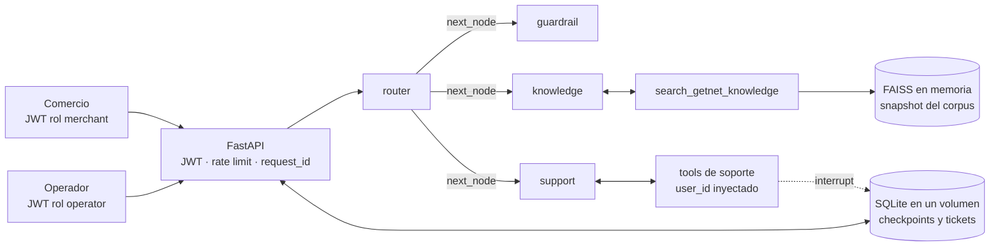

# Plan técnico: remediación V4

Estado: **aprobado el 2026-11-13**, con el ajuste de alcance de [DEC-018](decisiones.md#dec-018) (prueba técnica con entrega hoy). Implementa la [especificación](especificacion.md) y respeta la [constitución](constitucion.md).

## 1. Arquitectura objetivo

La línea discontinua es la pausa del HITL. El contrato del enunciado (router → `next_node` → `add_conditional_edges`) no cambia. El supervisor de colaboración (F8) queda para la siguiente iteración.

## 2. Fases

Orden de ejecución ([DEC-020](decisiones.md#dec-020)):

| Orden | Fase | Contenido | Requisitos | Prio | Tamaño |
|---|---|---|---|---|---|
| 1 | F0 + F1 | Specs, tag de lo evaluado, lockfile, Docker local, tests versionados y CI | EVID-01 a EVID-03 | A | S |
| 2 | F2 | Identidad: JWT, `user_id == sub`, `InjectedState`, `request_id` y logs seudonimizados | SEC-01 a SEC-04, OBS-01 | A | S |
| 3 | F4 + F5 | Memoria con propietario y HITL con tickets y operador (bloque todo o nada) | MEM-01 a MEM-05, HITL-01 a HITL-04, SEC-06 | B | M |
| 4 | F3 | Corpus ampliado con procedencia y evaluaciones de recuperación y routing (y de respuestas si cabe) | RAG-01 a RAG-04, EVID-04 a EVID-08 | A | M |
| 5 | F9 | README con tabla de evidencias, specs al día y tag | Todos | A | S |
| 6 | F6 | Tokens, coste y `/health/ready`, solo si sobra tiempo | OBS-02, OBS-04 | C | S |
| — | F7, F8 | Búsqueda híbrida, umbral y colaboración: siguiente iteración | RAG-05, RAG-06, ORQ | Fuera | — |

Por qué este orden: F1 protege todo lo demás; F2 es requisito de F4 y F5 ([DEC-006](decisiones.md#dec-006)); F4 y F5 forman el bloque con más puntos en juego y no se pueden entregar a medias, así que van mientras hay margen; F3 se puede entregar por partes, así que cierra.

## 3. Línea de corte para hoy

Entrega preferida antes de las 18:00 (CST), con margen hasta las 19:00 ([Q-006](preguntas.md#q-006)). El trabajo empieza a las 15:50.

| Hasta | Hito |
|---|---|
| 16:35 | F0 + F1 integrados en `main` |
| 17:00 | F2 integrado |
| 17:50 | F4 + F5 integrados |
| 18:35 | F3 integrado |
| 18:50 | F9: README, specs y tag; `main` congelado |

Reglas:

1. `main` es entregable después de cada merge: si a las 18:00 conviene enviar, se envía lo integrado.
2. F4 y F5 entran juntas o no entran (principio 4 de la [constitución](constitucion.md)). Si a las 17:50 no están en verde, se aparcan y se pasa a F3.
3. Si falta tiempo, F3 se recorta en este orden: primero la evaluación de respuestas y después la de routing. El corpus y la evaluación de recuperación no se recortan.
4. Lo que no entre pasa a la tercera oportunidad, en el mismo orden.

## 4. Flujo de trabajo en git

- Una rama por fase (`f1-tests-ci`, `f2-identidad`…) y un PR que cita requisitos, evidencia y decisiones.
- CI en verde → squash merge a `main` hecho por Claude ([DEC-021](decisiones.md#dec-021)).
- Tag `v4-evaluated` en `1119c8b` (lo evaluado) y `v5-reevaluacion` al cerrar.
- Cada PR marca sus tareas en [tareas.md](tareas.md) con el enlace a la evidencia.

## 5. Diseño por fase

### F1: tests y CI

- La prueba e2e offline existente (17 comprobaciones) pasa a `tests/`. Solo se sustituye el cliente HTTP de Groq; FastAPI, LangGraph, tools y RAG son reales.
- `tests/conftest.py` con las fixtures `fake_groq` (respuestas guionizadas), `client` (ASGI) y `offline_corpus` (HTML local).
- `.github/workflows/ci.yml`: job `test` (Python 3.11, ruff, pytest y evaluación de recuperación) y job `docker` (build con caché, arranque con clave ficticia, espera a *healthy* y smoke de `/chat`).
- Sin refactor: `main.py` sigue siendo el módulo principal ([DEC-018](decisiones.md#dec-018)).

### F2: identidad

- PyJWT con HS256 y `JWT_SECRET` (≥ 32 bytes); `iss`, `aud` y `exp` obligatorios; `scripts/issue_token.py` para desarrollo ([DEC-015](decisiones.md#dec-015)).
- Dependencia `get_principal()` → `Principal(sub, role)`. `/chat` exige rol `merchant` y `user_id == sub`; el estado del grafo recibe `sub`.
- Tools de soporte con `InjectedState` y `ToolNode` en lugar del nodo propio ([DEC-007](decisiones.md#dec-007)).
- Middleware de `request_id` y seudónimo HMAC de `sub` en los logs.

### F3: evaluaciones y corpus

- `scripts/ingest.py`: sitemap → URLs EN permitidas por robots.txt → WebBaseLoader con `parse_only=SoupStrainer("main")` → `data/corpus/` con snapshot y manifest (URL, título, fecha, sha256).
- Al arrancar, el índice se construye desde el snapshot. Si no existe, se descarga `https://www.getnet.net/en` como en v4 (BASE-04).
- Procedencia: la tool devuelve fragmentos numerados con su URL y la API devuelve `sources`.
- `evals/`: `datasets/` (JSONL), runners, métricas, `thresholds.yaml`, `gate.py` y `reports/`.
- Línea base: la evaluación de recuperación se ejecuta contra el índice v4 (solo la home) y contra el snapshot, en el mismo informe.
- Juez: un modelo distinto del evaluado, orientativo y no bloqueante ([DEC-011](decisiones.md#dec-011)).

### F4: memoria

- `AsyncSqliteSaver` sobre `STATE_DB` (un archivo en un volumen de Docker); `:memory:` en tests ([DEC-019](decisiones.md#dec-019)).
- `conversation_id` = UUID4 generado por el servidor = `thread_id`. El estado del hilo guarda el `sub` del dueño; si no coincide → 404.
- `/chat` acepta `conversation_id` opcional y lo devuelve; `GET /conversations/{id}` para el dueño.
- `trim_messages` limita lo que llega al LLM.
- Compose monta un volumen para el archivo SQLite, así que la conversación sobrevive a los reinicios.

### F5: HITL

- Tools nuevas: `request_refund(transaction_id, reason)` y `escalate_to_human(summary)`. Ambas llaman a `interrupt()` antes de cualquier efecto, así que reanudar es idempotente.
- La API detecta `__interrupt__`, crea el ticket en la tabla `tickets` del mismo SQLite y responde `status: "pending_human"` con `ticket_id`.
- Operador: `GET /operator/tickets`, `POST /operator/tickets/{id}/claim` y `POST /operator/tickets/{id}/resolve` (`approve`, `reject` o `reply`) → `Command(resume=…)`.
- Con un ticket abierto, `/chat` sobre esa conversación → 409.

### F6: observabilidad (solo si sobra tiempo)

- `UsageMetadataCallbackHandler` por petición → tokens por modelo; coste estimado con una tabla de precios configurable.
- Tiempos por nodo en logs y en `/metrics` (prometheus-client).
- `/health/live` y `/health/ready`; el HEALTHCHECK de Docker usa `ready`.

### F7: RAG v2 (siguiente iteración)

- BM25 (`rank_bm25`) + FAISS con fusión RRF (k = 60).
- Umbral elegido con el holdout, que incluye consultas sin respuesta en el corpus; por debajo, el agente dice que no tiene la información.
- Reranker solo si la evaluación muestra mejora.

### F8: colaboración (siguiente iteración)

- Tras cada especialista, un `supervisor` (salida estructurada, enum cerrado, fail-closed) decide `knowledge`, `support` o `finish`; contador `hops` en el estado (máximo 3).
- Si intervinieron dos especialistas, un nodo `synthesizer` compone la respuesta.
- El router de entrada y `next_node` se mantienen (BASE-03 y BASE-06).

## 6. Pruebas y evaluación

| Capa | Qué comprueba | Dónde corre | LLM real |
|---|---|---|---|
| Unitarias | JWT, identidad, PAN, RRF y gate | CI, cada push | No |
| Integración | Grafo y API con Groq simulado en la frontera HTTP | CI, cada push | No |
| Contrato | Petición real a Groq (schema y `tool_choice`) capturada por el fake | CI, cada push | No |
| Contenedor | Build, arranque, health y 401 | CI, cada push | No |
| Recuperación | recall@4, MRR@10 y nDCG@10 contra el holdout | CI, cada push | No |
| Routing y respuestas | Accuracy, bloqueo, fuente, hechos clave y juez | Manual; informe versionado | Sí |

## 7. Presupuesto de Groq (plan gratuito)

Son estimaciones. Durante la ejecución se ajustan con las cabeceras `x-ratelimit-*`, y la ejecución se detiene si el presupuesto restante baja del margen.

| Ejecución | Casos | Tokens (≈) | Modelo |
|---|---:|---:|---|
| Routing: línea base y final | 30 × 2 | 50K | `openai/gpt-oss-120b` |
| Respuestas: antes y después del corpus | 10 × 2 | 80K | `openai/gpt-oss-120b` |
| Margen para pruebas manuales | — | 70K | `openai/gpt-oss-120b` |
| **Total del modelo evaluado** | | **200K** | límite diario |
| Juez | — | — | fuera de hoy ([DEC-018](decisiones.md#dec-018)) |

## 8. Riesgos (premortem)

| ID | Riesgo | Mitigación | Tareas |
|---|---|---|---|
| F1 | Memoria o HITL sin AuthN activan el *Critical Security Gate* (tope 6.0) | F2 antes que F4 y F5; test de acceso cruzado en el mismo PR | T-020 a T-022, T-041 |
| F2 | Demasiados frentes y ninguno cerrado con evidencia | Prioridades A/B/C, línea de corte y definición de hecho | Todas |
| F3 | CI roja por la cuota de Groq o por las dependencias | CI sin LLM y lockfile | T-003, T-013 |
| F4 | Evidencia que el evaluador no ve | Informes versionados y tabla de evidencias | T-036, T-090 |
| F5 | El menú repetido degrada la recuperación | Solo `<main>`, test de duplicados y evaluación | T-030, T-031 |
| F6 | El supervisor empeora el routing sin que se note | Línea base en F3 y comparación en F8 | T-036, T-081 |
| F7 | Romper el contrato del enunciado | Principio 2, `InjectedState` y `user_id == sub` | T-021, T-022 |

## 9. Definición de hecho

Una tarea está hecha cuando:

1. Tiene un test que falla sin el cambio, o un informe de evaluación versionado.
2. La CI del PR está en verde.
3. [tareas.md](tareas.md) enlaza la evidencia.
4. El README y las specs reflejan el comportamiento nuevo.
5. No hay secretos en el repo ni en los logs.
